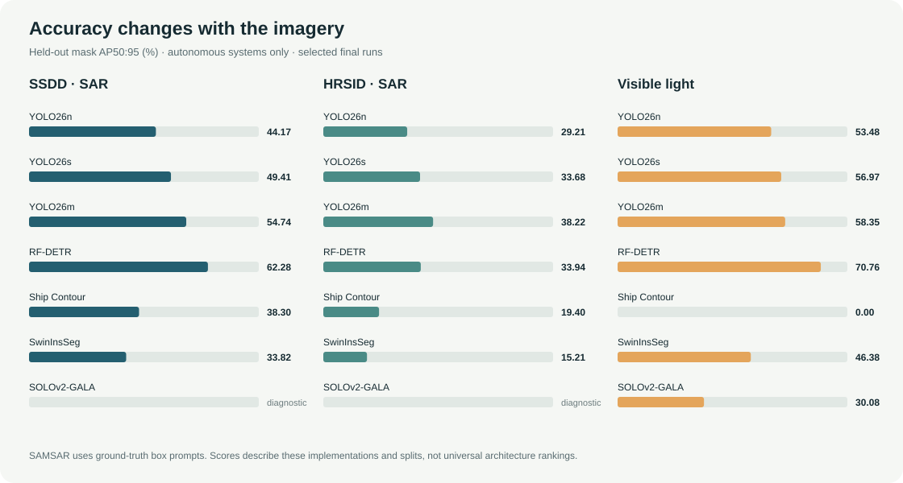
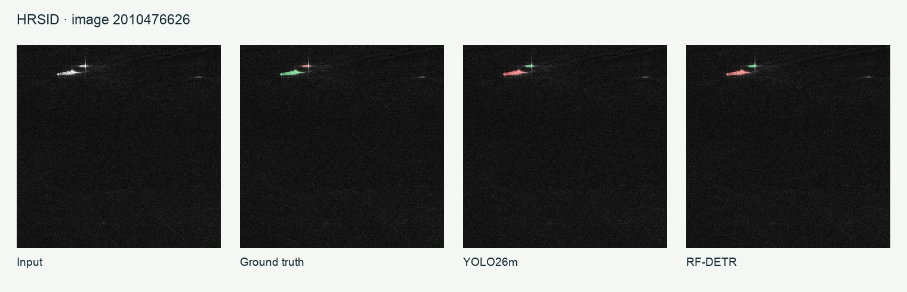
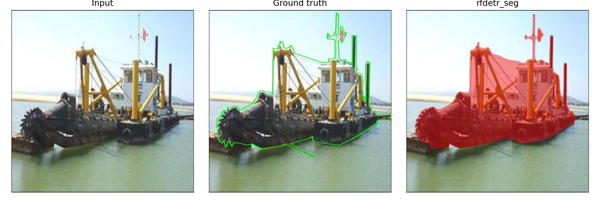

# Maritime ship segmentation

**A comparative honours study across SAR and visible-light imagery.**

[Explore the project](https://laithabuhannun.github.io/maritime-ship-segmentation/) · [Read the report](docs/report/Honours_Research_Report.pdf) · [Browse the code](experiments/) · [Reproduce / inspect](REPRODUCING.md)



## The question

Can image-based ship segmentation complement vessel-reporting systems such as AIS and LRIT, and which implementations offer a useful accuracy–speed trade-off? This project compares six existing model families (eight variants) on SSDD, HRSID and a visible-light ship dataset, with external SAR transfer to LS-SSD. It is a research benchmark, not a deployed AMSA system.

**Laith Abuhannun** · Bachelor of Computing Science (Honours), UTS · 2026  
Supervisor: Dr Nabin Sharma

## What I built

- Data preparation with deterministic seed-42 splits, source grouping and exact-duplicate checks.
- Training/validation pipelines with durable histories, early stopping, selected checkpoints and ClearML logging.
- A common mask evaluator (AP50:95, AP50, AP75, precision, recall, F1 and object-size AP), plus an end-to-end FPS benchmark.
- External box-based evaluation of SSDD-trained models on LS-SSD.
- Quantitative and same-image qualitative comparisons, including unsuccessful runs and limitations.

This is implementation/adaptation and evaluation of existing architectures, not a new segmentation architecture. Model-specific optimisation and GPU settings are disclosed in the report and saved configs.

## Results at a glance

Held-out **mask AP50:95 (%)**, autonomous implementations:

| Model | SSDD | HRSID | Visible light |
|---|---:|---:|---:|
| YOLO26n | 44.17 | 29.21 | 53.48 |
| YOLO26s | 49.41 | 33.68 | 56.97 |
| YOLO26m | 54.74 | 38.22 | 58.35 |
| RF-DETR | 62.28 | 33.94 | 70.76 |
| Ship Contour | 38.30 | 19.40 | 0.00 |
| SwinInsSeg | 33.82 | 15.21 | 46.38 |
| SOLOv2-GALA | diagnostic | diagnostic | 30.08 |

RF-DETR led SSDD (**62.28%**) and visible light (**70.76%**); YOLO26m led HRSID (**38.22%**). On the same visible A100 hardware, YOLO26m reached **25.02 FPS**, compared with **7.64 FPS** for RF-DETR. This illustrates a task-specific trade-off, not a universal winner.

**SAMSAR is prompted:** mask AP50:95 was 67.56 / 36.61 / 67.71 on SSDD / HRSID / visible imagery with ground-truth boxes supplied. It is reported separately because target locations were given. SAR SOLOv2 produced zero AP in diagnostic runs. Visible Ship Contour was near zero and needs implementation review.

## See the predictions





The HRSID panel uses image 2010476626 at each model's validation-selected threshold. Colours distinguish masks, not correctness. The visible triptych is a retained report example; its original image identifier was unavailable, so it is qualitative evidence, not an independently verified test identity. More examples and native loss/AP grids are on the [project page](https://laithabuhannun.github.io/maritime-ship-segmentation/#evidence).

## Report and code

- **[Full honours report (PDF)](docs/report/Honours_Research_Report.pdf)** — methods, complete metrics, training curves, visual comparisons and discussion. This is an honours research report, not a peer-reviewed publication. Public copy has the student number removed.
- **[Colab notebooks](notebooks/)** — SAR and visible workflows, retained outputs where available.
- **[Historical source and per-run configs](experiments/)** — source versions matched to selected SAR runs; visible study implementation.
- **[Metrics and histories](results/)** — machine-readable evidence and run selection metadata.
- **[Sources and credits](CREDITS.md)** — papers, upstream packages, data provenance and tool assistance.

## Run a lightweight inspection

```bash
python3 scripts/inspect_results.py --dataset visible
python3 scripts/validate_portfolio.py
```

No GPU or external dependency is needed for these inspection commands. See [REPRODUCING.md](REPRODUCING.md) before attempting legacy CUDA training.

## Interpretation limits

One seed and selected subsets were used. Some SAR FPS measurements used different GPU types; loss scales and input resolutions vary. SAMSAR uses ground-truth prompts. LS-SSD evaluates 500 ship-containing images with boxes, not masks. This study did not validate live AMSA integration, vessel identity, vessel type classification, geolocation or operational reliability. The report discusses these limits rather than treating benchmark accuracy as deployment proof.
